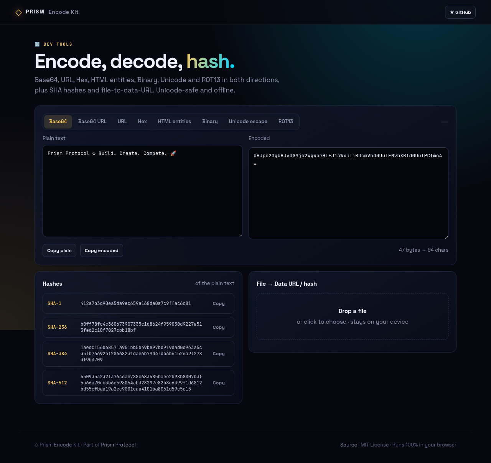
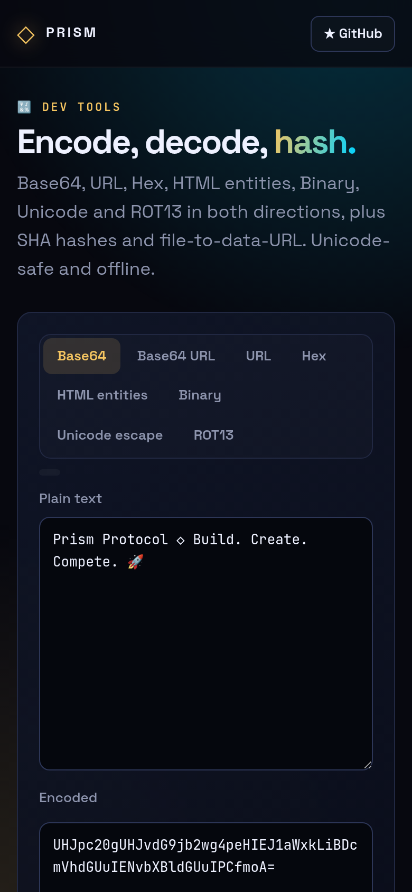

<!-- ═════════════ HEADER ═════════════ -->
<p align="center">
  
</p>

<p align="center">
  
</p>

<p align="center">
  <a href="https://github.com/krishyaa06/prism-encode-kit/actions/workflows/ci.yml"></a>
  <a href="https://krishyaa06.github.io/prism-encode-kit/"></a>
  
  
  <a href="LICENSE"></a>
</p>

<p align="center">
  
</p>


## ⚡ Overview

**Prism Encode Kit** is the everyday encoding toolbox. Type on either side and the other updates instantly, in eight formats. It is fully Unicode-safe (emoji and non-Latin scripts work), auto-detects the format you paste, computes SHA hashes with Web Crypto, and converts files into data URLs without uploading them.

## ✨ Features

- **8 codecs**, both directions: Base64, Base64 URL, URL, Hex, HTML entities, Binary, Unicode escape, ROT13
- **Unicode-safe** via UTF-8 TextEncoder/Decoder
- **Auto-detect** the encoding of pasted text
- **SHA-1 / 256 / 384 / 512** hashes, live
- **File → data URL** with SHA-256 checksum and image preview
- Helpful error messages for invalid input

## 📸 Screenshots

<table>
  <tr>
    <td width="68%"></td>
    <td width="32%"></td>
  </tr>
</table>

## 🚀 Quick Start

**Use it online:** [https://krishyaa06.github.io/prism-encode-kit/](https://krishyaa06.github.io/prism-encode-kit/)

**Run locally:**

```bash
git clone https://github.com/krishyaa06/prism-encode-kit.git
cd prism-encode-kit
# open index.html in your browser, or serve it:
npx serve .
```

## 🛠️ Usage

- Choose a codec tab, then type in **Plain text** to encode or in **Encoded** to decode.
- Hashes update for whatever is in the plain side.
- Drop any file to get its data URL and SHA-256.

## 📁 Project Structure

```
prism-encode-kit/
├── assets/
│   ├── logo.png
│   └── logo.svg
├── css/
│   ├── app.css
│   └── prism.css
├── js/
│   ├── app.js   # UI wiring
│   ├── core.js   # codecs, hashing, detection — tested in Node
│   └── prism.js
├── test/
│   └── core.test.js
├── .gitignore
├── LICENSE
├── index.html
└── package.json
```

## 🧪 Tests

```bash
npm test
```

Tests use the built-in `node:test` runner, so there is nothing to install. CI runs them on Node 20 and 22.

## 🤝 Contributing

1. Fork the repo and create a branch: `git checkout -b feature/my-idea`
2. Make your change and add a test in `test/`
3. Run `npm test` and open a Pull Request

## 🔷 Part of Prism Protocol

Prism Encode Kit is one of the open-source tools built by [Prism Protocol](https://dc.gg/prismprotocol), a tech community where young builders learn, ship and compete together.

## 👤 Author

<table>
  <tr>
    <td align="center">
      <a href="https://github.com/krishyaa06"><br><b>Soumya Bhandare</b></a><br>
      <sub>Founder @ Prism Protocol</sub>
    </td>
    <td>
      <a href="https://dc.gg/prismprotocol"></a><br>
      <a href="https://instagram.com/prism_protocol_"></a><br>
      <a href="https://x.com/krishyaa06"></a>
    </td>
  </tr>
</table>

## 📄 License

Released under the [MIT License](LICENSE).

<p align="center">
  <b>If you like this project, consider giving it a ⭐</b><br>
  <sub>"Build. Create. Compete." · Made with ⚡ by Prism Protocol</sub>
</p>


